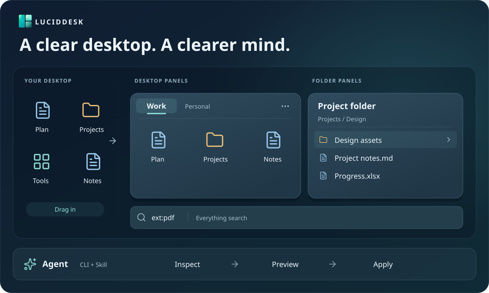

<div align="center">


# LucidDesk

[简体中文](README.md) · English

**Turn your Windows desktop into a workspace you can organize yourself—or with an agent.**

Desktop panels · Auto-classify · Folder panels · Everything search · Spacebar preview · Agent integration

[](LICENSE)
[](https://github.com/Yuch3nE/luciddesk/actions/workflows/build.yml)
[](CHANGELOG.en.md)
[](#compatibility)
[](docs/portable.md)

[🌐 Website](https://luciddesk.bbkingdom365.com/) · [⬇️ Download](https://github.com/Yuch3nE/luciddesk/releases/latest) · [✨ Explore](https://luciddesk.bbkingdom365.com/features/) · [📖 User guide](https://luciddesk.bbkingdom365.com/guide/) · [📋 Changelog](CHANGELOG.en.md)

</div>

LucidDesk is a free, open-source native desktop organizer for Windows. Group icons into clean panels, sort clutter automatically with classification rules, map frequently used folders directly onto your desktop, and search or preview files in place. Its bundled CLI and Skill also let external agents inspect and organize your workspace safely.



<sub>Feature illustration. See screenshots below for the actual interface.</sub>

[Get started](#getting-started) · [Features](#features) · [Screenshots](#screenshots) · [Upgrading](#upgrading-and-backups) · [FAQ](#troubleshooting)

> **What’s new in 0.26.1:** Automatic desktop icon classification, preview-first one-click organization with undo, signed in-app updates, dragging files from desktop panels into Windows Terminal and other apps, and smoother panel behavior during `Win + D` and tab merging. See the [changelog](CHANGELOG.en.md#0261--2026-11-15).

<a id="getting-started"></a>

## 🚀 Get started

[Download from GitHub Releases](https://github.com/Yuch3nE/luciddesk/releases/latest). The **installer** is recommended for everyday use. All three packages include the exact same features and support signed in-app updates:

| Package | Choose it if you want… | Settings location |
| --- | --- | --- |
| Installer (`*-setup.exe`) | Setup wizard, Start menu shortcut, and uninstall entry | `%LOCALAPPDATA%\LucidDesk` |
| Standard ZIP (without `portable` in its name) | No installation, keeping settings separate from program files | `%LOCALAPPDATA%\LucidDesk` |
| Portable ZIP (`portable` in its name) | Settings carried inside the app folder for easy portability | The `data` folder beside the app |

1. Install or fully extract the package and launch `luciddesk.exe` (keep all bundled ZIP files together; do not run directly inside an archive).
2. Right-click the tray icon, choose **New panel**, and drag desktop icons into it.
3. Drag the header to move a panel and its edges to resize it. Click **…** in the header (or right-click empty panel space) to adjust view, sorting, and arrangement.

To browse a directory directly on the desktop, choose **New folder panel…** from the tray menu. Closing Settings does not exit the app; choose **Exit LucidDesk** in the tray menu to quit.

See the [user manual](docs/usage.en.md) for everyday workflows and the [online installation guide](https://luciddesk.bbkingdom365.com/installation/) for package and migration details.

<a id="features"></a>

## ✨ Features

| Feature | What you can do |
| --- | --- |
| Desktop panels and tabs | Group icons by project, merge or detach tabs, and switch between filled and left-aligned tab bars |
| Automatic classification | Route new icons by extension, keyword, regex, or icon type; includes built-in templates, inline condition summaries, preview-first **Organize now**, and undo |
| Flexible arrangement | Auto-arrange, align to grid, or position freely; sort by name, modified date, type, or size |
| Per-panel display | Choose **Icons and names**, **Icons only** (Small / Medium / Large), or **List** view independently for every desktop or folder panel |
| Folder panels | Browse directories and subfolders directly on the desktop with automatic refresh on file changes |
| Search and preview | Search local files with Everything and press Space to preview any selected file |
| Appearance and focus | Customize themes, materials (Solid / Acrylic / Mica / Mica Alt), rendering mode, corners, fonts, and snap gap; collapse, auto-collapse, lock, or pin panels on top |
| Double-click to hide | Enable in **Settings → General**, then double-click empty desktop space to hide or restore icons and panels |
| Backup and restore | Back up settings and layouts automatically or manually, export copies, restore snapshots, and undo a restore |
| Agents and CLI | Let an external agent inspect your workspace, preview and apply changes safely, or script panel and backup workflows |

> [!NOTE]
> **Desktop panels and automatic classification store icon references only—they never move your original files.** Drag icons back to the desktop to remove them; closing a panel never deletes files. File-menu actions such as delete, rename, and cut, as well as dropping or pasting into a folder panel, operate on real files.

### Search and preview

Both features are off by default and require separately installed software:

| Feature | Setup |
| --- | --- |
| File search | Install and run Everything (1.4 or newer with IPC enabled), then enable it in **Settings → Everything search** |
| Spacebar preview | Install PowerToys Peek or QuickLook, then select it and enable preview in **Settings → File preview** |

These tools are not bundled with LucidDesk and may have higher OS requirements (for example, current [PowerToys](https://learn.microsoft.com/windows/powertoys/install) requires Windows 10 2004 or later; LucidDesk’s 1809 minimum does not imply Peek support on 1809).

### Agents and the command line

Open **Settings → General → Automation**, verify **Allow CLI and Agent control** is on (enabled by default), and click **Copy prompt** under **Set up Agent skills** to paste into your agent. Keep the app, CLI, and Skill from the same release; copying the prompt does not install anything or alter your desktop.

With control enabled, run read-only queries from the application directory:

```powershell
.\luciddesk-cli.exe status --json
.\luciddesk-cli.exe pane list --json
```

Use a three-step workflow: inspect existing panels and items, preview changes, then apply after review. This command previews a new panel without saving it:

```powershell
.\luciddesk-cli.exe pane create --title "Work" --dry-run --json
```

- **Preview first:** Review the returned summary and diff, then follow `data.next_step`. Mutation commands without `--dry-run` preview and submit immediately.
- **Concurrency & timeouts:** If a submission times out, query its receipt before retrying to avoid duplicates. If a backup task is busy, follow the returned wait condition and preview again once idle.
- **Ready out of the box:** Structured JSON output and optional diagnostic logs with no bundled LLM or API key required.

See the [CLI guide](docs/cli.md#english-quick-start) for full commands and recovery, or the [bundled Skill](skills/luciddesk-control/SKILL.md) for agent integration. External agents may send filenames and paths to their providers; see the [privacy policy](PRIVACY.en.md).

<a id="screenshots"></a>

## 📸 Screenshots

| Desktop panel | Theme & materials |
| :---: | :---: |
| <a href="screenshot/en/pane.png"></a> | <a href="screenshot/en/setting.png"></a> |
| Drag in icons to organize your desktop | Customize the theme and background |
| **Folder panel** | **About & status** |
| <a href="screenshot/en/folder.png"></a> | <a href="screenshot/en/about.png"></a> |
| Browse folders with type, modified date, and size columns | View version, project links, and runtime status |

Click any screenshot to view full size. Screenshots show dark Acrylic; appearance varies with wallpaper and system settings. Mica and Mica Alt require Windows 11.

<a id="upgrading-and-backups"></a>

## 🔄 Upgrading and backups

Check for updates manually or automatically in **Settings → About**. When a signed update is available, click **Download and update**; LucidDesk verifies the package locally and updates in place once you confirm the restart. Save a backup in **Settings → Backup & restore** before upgrading.

- **Installer:** Exit the app and run the new installer using the same scope and directory.
- **Standard ZIP:** Exit the app and replace all program files while keeping your settings directory.
- **Portable:** Exit the app and replace program files while preserving the `data` folder and extensionless `portable` marker.

**Backups contain settings and layouts, not your original files.** When moving to another PC, transfer the referenced files separately. See [backup and restore](docs/usage.en.md#backup-and-restore).

<a id="languages"></a>
<a id="compatibility"></a>

## 🖥️ System and languages

| Environment | Support |
| --- | --- |
| Windows 11 x64 | Primary platform; Solid color, Acrylic, Mica, and Mica Alt |
| Windows 10 1809+ x64 | Tested by users; Solid color and Acrylic |
| ARM64 / Remote Desktop | Not fully validated |

Supports 7 interface languages: 简体中文, 繁體中文, English, 日本語, 한국어, Deutsch, and Русский. Follows the Windows display language by default (falling back to English) and switches immediately in **Settings → General → Language**.

<a id="troubleshooting"></a>

## 💬 FAQ

<details>
<summary>Panels take a long time to appear after sign-in</summary>

LucidDesk waits for desktop interfaces in the background and connects automatically once ready, retrying after Explorer restarts. Connection warnings are deferred for the first 30 seconds after startup or disconnection. If the app is running without panels, check **Desktop connection** and copy diagnostics in **Settings → About**. If the tray icon is also missing, check Task Manager—Windows may delay startup apps independently.

</details>

<details>
<summary>Icons take a long time to update after dragging</summary>

Desktop panels only update icon membership, whereas dropping files into a folder panel copies real files and depends on file size and disk speed. If a regular panel shows an unexpected delay, check connection status in **Settings → About** and report the drag direction, panel type, wait time, and diagnostics.

</details>

<details>
<summary>Icons and panels disappeared</summary>

Click the tray icon to show all panels. If **Double-click to hide desktop** is enabled, double-click empty desktop space again to restore them.

</details>

<details>
<summary>Desktop panels cannot connect</summary>

Check connection status in **Settings → About** and click **Reconnect**, and verify no other desktop organizer is running. The app retries automatically after Explorer restarts; if the issue persists, copy diagnostics for your report.

</details>

<details>
<summary>How do I report a problem?</summary>

Open an [issue](https://github.com/Yuch3nE/luciddesk/issues) with reproduction steps, expected vs. actual behavior, and diagnostics from **Settings → About → Copy diagnostics**. Include a screenshot and display scaling for UI issues, and strip personal paths or sensitive filenames before sharing.

</details>

<a id="documentation"></a>

## 📚 More help

[User manual](docs/usage.en.md) · [CLI quick start](docs/cli.md#english-quick-start) · [Changelog](CHANGELOG.en.md) · [Privacy policy](PRIVACY.en.md) · [Documentation index](docs/README.md) (Chinese)

<a id="build-from-source"></a>
<a id="contributing"></a>

## 🤝 Development and contributions

Bug reports, feature suggestions, translation improvements, and pull requests are welcome. Read the [contribution guide](CONTRIBUTING.en.md) before getting started.

LucidDesk is built with Rust, Win32, and Direct2D. See the [build guide](docs/development/build.md) for compilation and packaging, [development documentation](docs/development/README.md) for architecture and validation, and [website documentation](website/README.md) for site maintenance (technical guides are in Chinese).

Author: **Yuchen95**.

<a id="friends"></a>

## 🔗 Friends

[Linux DO](https://linux.do/)

<a id="license"></a>

## 📄 License

LucidDesk is licensed under the [MIT License](LICENSE). Third-party dependencies retain their respective licenses.
