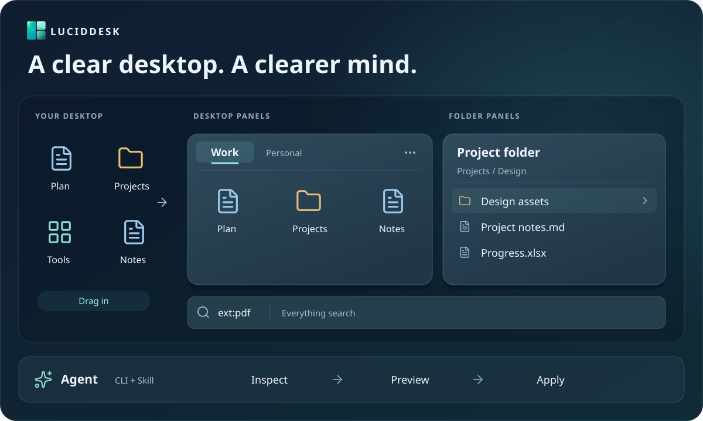

<div align="center">


# LucidDesk

[简体中文](README.md) · English

**Turn your Windows desktop into a workspace you can organize yourself or with an agent.**

Desktop panels · Folder panels · Everything search · Spacebar preview · Agent integration

[](LICENSE)
[](https://github.com/Yuch3nE/luciddesk/actions/workflows/build.yml)
[](CHANGELOG.en.md)
[](#compatibility)
[](docs/portable.md)

[🌐 Website](https://luciddesk.bbkingdom365.com/) · [⬇️ Download](https://github.com/Yuch3nE/luciddesk/releases/latest) · [✨ Explore](https://luciddesk.bbkingdom365.com/features/) · [📖 User guide](https://luciddesk.bbkingdom365.com/guide/) · [📋 Changelog](CHANGELOG.en.md)

</div>

LucidDesk is a free, open-source Windows desktop organizer. Group files and shortcuts into panels, keep frequently used folders within reach, and search or preview files from your desktop. The companion CLI and Skill also let an external agent help organize your workspace.



<sub>Feature illustration. See screenshots below for the actual interface.</sub>

[Get started](#getting-started) · [Features](#features) · [Screenshots](#screenshots) · [Upgrading](#upgrading-and-backups) · [FAQ](#troubleshooting)

<a id="getting-started"></a>

## 🚀 Get started

[Download from GitHub Releases](https://github.com/Yuch3nE/luciddesk/releases/latest). The **installer** is recommended for everyday use. All three packages have the same features.

| Package | Choose it if you want… | Settings location |
| --- | --- | --- |
| Installer (`*-setup.exe`) | A setup wizard, Start menu shortcut and uninstall entry | `%LOCALAPPDATA%\LucidDesk` |
| Standard ZIP (without `portable` in its name) | To run without installation, keeping settings separate | `%LOCALAPPDATA%\LucidDesk` |
| Portable ZIP (`portable` in its name) | To carry settings with the app folder | The `data` folder beside the app |

1. Install or fully extract the package and run `luciddesk.exe`. Keep all bundled files together; do not run the app inside the ZIP.
2. Right-click the tray icon, choose **New panel**, and drag desktop icons into it.
3. Drag the title to move the panel or its edges to resize it. Right-click the panel to change arrangement, view and icon size.

To browse a directory, choose **New folder panel…** from the tray menu. Closing Settings does not exit the app; use the tray menu to quit.

See the [user manual](docs/usage.en.md) for everyday tasks and the [online installation guide](https://luciddesk.bbkingdom365.com/installation/) for package and migration details.

<a id="features"></a>

## ✨ Features

| Feature | What you can do |
| --- | --- |
| Desktop panels and tabs | Group icons by project, merge or detach tabs, and choose a filled or left-aligned tab bar |
| Flexible arrangement | Arrange automatically, align to a grid or position freely; sort by name, type, date or size |
| Per-panel display | Choose icon or list view, icon-only mode, and small, medium or large icons for each desktop or folder panel |
| Folder panels | Browse directories and subfolders, with automatic refresh when files change |
| Search and preview | Search local files with Everything and press Space to preview a selected file |
| Appearance and focus | Customize themes, materials, fonts and corners; collapse, auto-hide, snap, lock or pin panels on top |
| Double-click to hide | Enable in General settings, then double-click empty desktop space to hide or restore icons and panels |
| Backup and restore | Back up settings and layouts automatically or manually, export copies and restore them |
| Agents and CLI | Let an external agent inspect the desktop, preview and apply changes, or use scripts to manage panels and backups |

> [!NOTE]
> **Organizing icons in a desktop panel does not move the original files.** Drag icons back to the desktop to remove them; removing a panel does not delete its files. File operations such as delete, rename and cut, as well as dropping or pasting into a folder panel, affect real files.

### Search and preview

Both features are off by default and require separately installed software:

| Feature | Setup |
| --- | --- |
| File search | Install and run Everything, then enable it in **Settings → Everything search** |
| Spacebar preview | Install PowerToys Peek or QuickLook, then select and enable it in **Settings → File preview** |

These tools are not bundled with LucidDesk.

### Agents and the command line

Copy the Skill installation prompt from **Settings → General → Agent & CLI** and give it to your agent. The app, CLI and Skill should come from the same release package. Copying the prompt does not install anything.

Enable CLI control in Settings, then run read-only queries from the application directory:

```powershell
.\luciddesk-cli.exe status --json
.\luciddesk-cli.exe pane list --json
```

Use three steps: query existing panels and items, preview changes, then apply after review. This command previews a new panel without saving it:

```powershell
.\luciddesk-cli.exe pane create --title "Work" --dry-run --json
```

Review the returned changes and follow `data.next_step`. **Mutation commands without `--dry-run` preview and submit immediately.** If a submission times out, query its original receipt before retrying; rerunning the mutation may duplicate it. For busy backups, follow the returned wait condition and preview again once idle.

JSON results and optional diagnostic logs support agents and scripts. LucidDesk does not include a language model or require a model API key. See the [CLI guide](docs/cli.md#english-quick-start) for commands and recovery, or the [bundled Skill](skills/luciddesk-control/SKILL.md) for agent integration. External agents may send filenames and paths to their providers; see the [privacy policy](PRIVACY.en.md).

<a id="screenshots"></a>

## 📸 Screenshots

| Desktop panel | Theme & materials |
| :---: | :---: |
| <a href="screenshot/en/pane.png"></a> | <a href="screenshot/en/setting.png"></a> |
| Drag in icons to organize your desktop | Customize the theme and background |
| **Folder panel** | **About & status** |
| <a href="screenshot/en/folder.png"></a> | <a href="screenshot/en/about.png"></a> |
| Browse folders with type, modified date and size columns | View the version, project links and runtime status |

Click a screenshot to view the original. These show dark Acrylic; the appearance varies with your wallpaper and system settings. Mica materials require Windows 11.

<a id="upgrading-and-backups"></a>

## 🔄 Upgrading and backups

Check for updates and download them from **Settings → About**. The app does not install updates automatically. Save a backup in **Backup & restore** before upgrading.

- **Installer:** exit the app and run the new installer, keeping the same installation scope and directory.
- **Standard ZIP:** exit the app and replace all program files, keeping the settings directory.
- **Portable:** exit the app and replace program files, preserving the `data` folder and `portable` marker.

**Backups contain settings and layouts, not your original files.** When moving to another computer, transfer the files referenced by panels separately. See [backup and restore](docs/usage.en.md#backup-and-restore).

<a id="languages"></a>
<a id="compatibility"></a>

## 🖥️ System and languages

| Environment | Support |
| --- | --- |
| Windows 11 x64 | Primary platform; solid color, Acrylic, Mica and Mica Alt |
| Windows 10 x64 | Tested by users; solid color and Acrylic |
| ARM64 / Remote Desktop | Not fully validated |

The interface supports 简体中文, 繁體中文, English, 日本語, 한국어, Deutsch and Русский. It follows the Windows display language by default and falls back to English for unsupported languages. Change it in **Settings → General**; changes apply immediately.

<a id="troubleshooting"></a>

## 💬 FAQ

<details>
<summary>Panels take a long time to appear after sign-in</summary>

LucidDesk checks desktop interfaces in the background and connects when they are ready. It also retries after Explorer restarts. If the app is running but panels have not returned, check the connection status and copy diagnostics in **Settings → About**. If the tray icon has not appeared either, first check Task Manager to see whether the app has started: Windows may delay startup applications. The readiness improvements in 0.25.1 do not remove that scheduling delay.

</details>

<details>
<summary>Icons and panels disappeared</summary>

Click the tray icon to show panels. If **Double-click to hide desktop** is enabled, double-click an empty desktop area again to restore them.

</details>

<details>
<summary>Desktop panels cannot connect</summary>

Check the connection status in **Settings → About** and try reconnecting. The app retries automatically after Explorer restarts. If the issue persists, copy diagnostics for your report.

</details>

<details>
<summary>How do I report a problem?</summary>

Open an [issue](https://github.com/Yuch3nE/luciddesk/issues) with reproduction steps, expected and actual behavior, and the information from **Settings → About → Copy diagnostics**. Include a screenshot and display scaling for UI problems. Check logs for personal paths before sharing.

</details>

<a id="documentation"></a>

## 📚 More help

[User manual](docs/usage.en.md) · [CLI quick start](docs/cli.md#english-quick-start) · [Changelog](CHANGELOG.en.md) · [Privacy policy](PRIVACY.en.md) · [Documentation index](docs/README.md) (Chinese)

<a id="build-from-source"></a>
<a id="contributing"></a>

## 🤝 Development and contributions

Bug reports, feature suggestions, translation improvements and pull requests are welcome. Read the [contribution guide](CONTRIBUTING.en.md) before getting started.

LucidDesk uses Rust, Win32 and Direct2D. See the [build guide](docs/development/build.md) for compilation and packaging, [development documentation](docs/development/README.md) for implementation and validation, and [website documentation](website/README.md) for site maintenance. These technical guides are in Chinese.

Author: **Yuchen95**.

<a id="friends"></a>

## 🔗 Friends

[Linux DO](https://linux.do/)

<a id="license"></a>

## 📄 License

LucidDesk is licensed under the [MIT License](LICENSE). Third-party dependencies retain their respective licenses.
