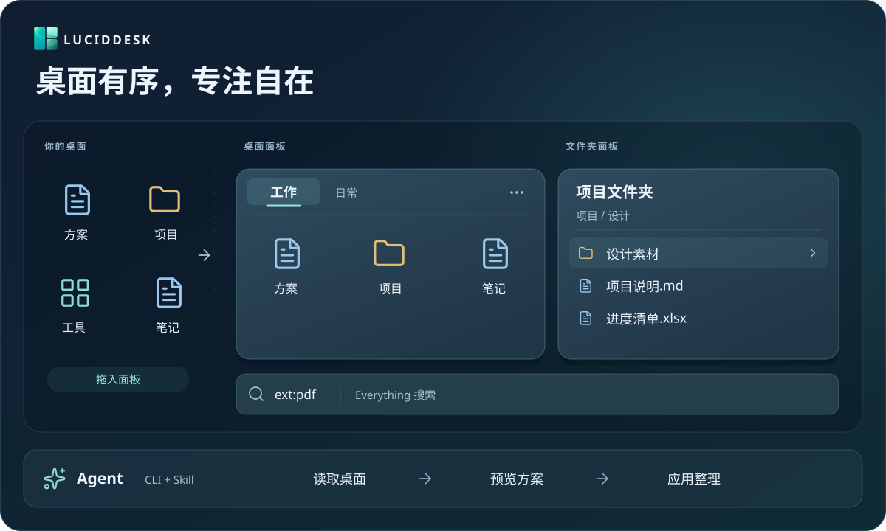

<div align="center">


# LucidDesk

简体中文 · [English](README.en.md)

**把 Windows 桌面整理成顺手的工作区，也能交给 Agent 协助打理。**

桌面面板 · 自动分类 · 文件夹面板 · Everything 搜索 · 空格预览 · Agent 联动

[](LICENSE)
[](https://github.com/Yuch3nE/luciddesk/actions/workflows/build.yml)
[](CHANGELOG.md)
[](#系统与兼容性)
[](docs/portable.md)

[🌐 官网](https://luciddesk.bbkingdom365.com/) · [⬇️ 下载](https://github.com/Yuch3nE/luciddesk/releases/latest) · [✨ 探索功能](https://luciddesk.bbkingdom365.com/features/) · [📖 使用指南](https://luciddesk.bbkingdom365.com/guide/) · [📋 更新记录](CHANGELOG.md)

</div>

LucidDesk 是一款免费、开源的原生 Windows 桌面整理工具。你可以用面板和自动分类规则收纳桌面图标、把常用目录直接映射到桌面、随时搜索与预览文件，也可以通过内置 CLI 与 Skill 让外部 Agent 协助管理工作区。



<sub>功能示意，实际界面见下方截图。</sub>

[开始使用](#开始使用) · [功能](#功能) · [界面截图](#界面截图) · [升级与备份](#升级与备份) · [常见问题](#常见问题)

> **0.26.1 新特性：** 新增桌面图标自动分类、一键整理预览与撤销、签名应用内更新；支持将普通面板中的文件直接拖入 Windows Terminal 等外部程序，并改进了 `Win + D` 与标签合并时的窗口表现。详见[更新记录](CHANGELOG.md#0261--2026-11-15)。

<a id="开始使用"></a>

## 🚀 开始使用

前往 [GitHub Releases 下载](https://github.com/Yuch3nE/luciddesk/releases/latest)，日常使用推荐 **安装版**。三种发布包功能完全一致，均支持签名应用内更新：

| 发布包 | 适合场景 | 配置保存位置 |
| --- | --- | --- |
| 安装版（`*-setup.exe`） | 向导安装，自动创建开始菜单快捷方式与卸载入口 | `%LOCALAPPDATA%\LucidDesk` |
| 普通 ZIP（名称不含 `portable`） | 免安装解压即用，程序与配置分开存放 | `%LOCALAPPDATA%\LucidDesk` |
| 便携 ZIP（名称含 `portable`） | 配置随程序目录携带或整包迁移 | 程序目录中的 `data` |

1. 安装或完整解压后启动 `luciddesk.exe`（使用 ZIP 版时请保留全部文件，不要直接在压缩包内运行）。
2. 右键任务栏托盘图标，选择 **新建面板**，将桌面图标拖入面板即可开始收纳。
3. 拖动标题栏移动面板、拖动边缘调整大小；点击标题栏 **…** 或右键面板空白处，可调整视图、排序与排列方式。

要浏览常用目录，在托盘菜单选择 **新建文件夹面板…**。关闭设置窗口不会退出程序；需要退出时，请在托盘菜单选择 **退出 LucidDesk**。

更多日常操作见[使用手册](docs/usage.md)；安装、更新与迁移详见[安装版](docs/installer.md)、[普通 ZIP](docs/package.md) 和[便携版](docs/portable.md)说明。

<a id="功能"></a>

## ✨ 功能

| 功能 | 说明 |
| --- | --- |
| 桌面面板与标签 | 按项目收纳图标，支持合并或分离标签页，标签栏支持铺满和左对齐 |
| 自动分类与一键整理 | 按扩展名、关键字、正则表达式或图标类型自动归类新图标；内置规则模板、条件摘要表、预览确认与撤销整理 |
| 灵活排列与排序 | 支持自动排列、对齐网格或自由摆放，可按文件名、修改时间、类型或大小排序 |
| 独立显示模式 | 每个普通面板与文件夹面板可独立选择 **图标与名称**、**仅图标**（小 / 中 / 大）或 **列表** 视图 |
| 文件夹面板 | 在桌面直接浏览常用目录与子文件夹，文件变更自动刷新 |
| 搜索与空格预览 | 接入 Everything 极速检索本机文件，选中文件按空格即可预览 |
| 外观与专注 | 自定义主题、材质（纯色 / 亚克力 / Mica / Mica Alt）、渲染模式、圆角、字体与吸附间距；支持收起、自动收起、锁定与始终置顶 |
| 双击隐藏桌面 | 在 **设置 → 通用** 开启后，双击桌面空白处隐藏图标与面板，再次双击恢复 |
| 备份与恢复 | 自动或手动备份设置与布局，支持导出副本、历史恢复与撤销本次恢复 |
| Agent 与 CLI | 让外部 Agent 查询工作区、预览整理方案并安全执行，或用脚本自动化管理面板与备份 |

> [!NOTE]
> **普通桌面面板收纳和自动分类只保存图标引用，不会移动原文件。** 拖回桌面即可移出，关闭面板也不会删除原文件。文件右键菜单中的删除、重命名、剪切，以及向文件夹面板拖入或粘贴内容，才会作用于真实文件。

### 搜索与预览

这两项功能默认关闭，需要另行安装对应工具：

| 功能 | 准备与启用方式 |
| --- | --- |
| 文件搜索 | 安装并运行 Everything（1.4 及以上并开启 IPC），在 **设置 → Everything 搜索** 中启用 |
| 空格预览 | 安装 PowerToys Peek 或 QuickLook，在 **设置 → 文件预览** 中选择程序并启用 |

上述工具不包含在 LucidDesk 发布包内，各自具备独立的系统要求（例如当前 [PowerToys](https://learn.microsoft.com/windows/powertoys/install) 需要 Windows 10 2004 及以上，LucidDesk 支持 1809 并不代表 Peek 在 1809 可用）。

### Agent 与命令行

打开 **设置 → 通用 → 自动化**，确认 **允许 CLI 与 Agent 控制** 已开启（默认开启），点击 **配置 Agent 技能** 中的 **复制提示词** 发送给你的 Agent 即可（主程序、CLI 与 Skill 需来自同一发布版本；复制提示词本身不会安装技能或改动桌面）。

启用控制后，可在程序目录执行只读查询：

```powershell
.\luciddesk-cli.exe status --json
.\luciddesk-cli.exe pane list --json
```

推荐采用「查询 → 预览 → 确认应用」三步流程。例如，仅预览新建一个面板而不保存：

```powershell
.\luciddesk-cli.exe pane create --title "工作" --dry-run --json
```

- **安全预览**：核对返回的变更摘要与差异后，按 `data.next_step` 指引继续；不带 `--dry-run` 的修改命令会直接预览并提交。
- **并发与超时**：提交超时请先查询原请求回执，避免重复操作；若提示备份任务忙碌，按返回条件等待后再重新预览。
- **开箱即用**：提供结构化 JSON 输出与可选诊断日志，不内置大模型、无需配置 API 密钥。

完整命令见 [CLI 指南](docs/cli.md)，Agent 接入见[配套 Skill](skills/luciddesk-control/SKILL.md)。外部 Agent 可能将文件名与路径发送给其服务商，详见[隐私说明](PRIVACY.md)。

<a id="界面截图"></a>

## 📸 界面截图

| 桌面面板 | 主题与材质 |
| :---: | :---: |
| <a href="screenshot/zh/pane.png"></a> | <a href="screenshot/zh/setting.png"></a> |
| 拖入图标，按需折叠与整理 | 调整深浅主题与背景材质 |
| **文件夹面板** | **关于与运行状态** |
| <a href="screenshot/zh/folder.png"></a> | <a href="screenshot/zh/about.png"></a> |
| 浏览常用目录，查看类型、修改时间与大小 | 查看版本、项目入口与运行状态 |

点击截图可查看原图。以上为深色亚克力效果，实际观感随壁纸与系统设置变化；Mica 与 Mica Alt 材质需 Windows 11。

<a id="升级与备份"></a>

## 🔄 升级与备份

可在 **设置 → 关于** 手动或自动检查更新。检测到可用的签名更新时，点击 **下载并更新**，应用将在本地校验发行包，经你确认重启后完成原位更新。升级前建议先在 **设置 → 备份与恢复** 保存备份。

- **安装版**：退出程序后运行新版安装包，沿用原安装范围与目录。
- **普通 ZIP**：退出程序后完整替换程序文件，保留用户配置目录。
- **便携版**：退出程序后替换程序文件，保留 `data` 文件夹与无扩展名的 `portable` 标记文件。

**备份只包含设置与布局，不包含原始文件。** 换电脑时请单独迁移面板引用的文件，详见[使用手册](docs/usage.md#数据与备份)。

<a id="界面语言"></a>
<a id="系统与兼容性"></a>

## 🖥️ 系统与语言

| 环境 | 支持情况 |
| --- | --- |
| Windows 11 x64 | 主要维护平台；支持纯色、亚克力、Mica 与 Mica Alt |
| Windows 10 1809+ x64 | 已由用户实机验证；支持纯色与亚克力 |
| ARM64、远程桌面 | 尚未完整验证 |

内置简体中文、繁體中文、English、日本語、한국어、Deutsch 和 Русский 共 7 种界面语言。默认跟随 Windows 显示语言（未覆盖语言回退到英文），可在 **设置 → 通用 → 语言** 随时切换并立即生效。

<a id="常见问题"></a>

## 💬 常见问题

<details>
<summary>登录后面板迟迟没有出现？</summary>

LucidDesk 会在后台等待桌面接口就绪后自动连接，Explorer 重启后也会自动重连；启动或断线后的前 30 秒暂缓弹出连接告警。若程序已在运行但面板未出现，请在 **设置 → 关于** 查看桌面连接状态并复制诊断信息。若托盘图标也未出现，请先在任务管理器确认程序是否已被系统启动（Windows 可能会延后调度开机自启项）。

</details>

<details>
<summary>拖入面板或拖回桌面后刷新偏慢？</summary>

普通桌面面板仅更新图标归属；向文件夹面板拖入文件涉及真实文件复制，耗时会受文件大小与磁盘速度影响。若普通面板仍出现异常延迟，请在 **设置 → 关于** 查看连接状态，记录拖动方向、面板类型和等待时长并附诊断信息反馈。

</details>

<details>
<summary>图标和面板突然不见了？</summary>

点击托盘图标即可显示所有面板。若开启了 **双击隐藏桌面**，再次双击桌面空白处即可恢复。

</details>

<details>
<summary>桌面面板无法连接？</summary>

请在 **设置 → 关于** 查看连接状态并点击 **重新连接**，同时避免运行其他桌面整理软件。Explorer 重启后程序会自动重试；若持续失败，请复制诊断信息用于反馈。

</details>

<details>
<summary>如何反馈问题？</summary>

前往 [GitHub Issues](https://github.com/Yuch3nE/luciddesk/issues) 提交复现步骤、预期与实际表现，并附上 **设置 → 关于 → 复制诊断信息** 的内容。界面问题建议附截图和缩放比例，分享前请自行清理个人路径或敏感文件名。

</details>

<a id="文档"></a>

## 📚 更多帮助

[使用手册](docs/usage.md) · [CLI 指南](docs/cli.md) · [更新记录](CHANGELOG.md) · [隐私说明](PRIVACY.md) · [文档导航](docs/README.md)

<a id="源码构建"></a>
<a id="参与开发"></a>

## 🤝 开发与贡献

欢迎提交问题反馈、功能建议、翻译改进或 Pull Request。参与开发前请先阅读[贡献指南](CONTRIBUTING.md)。

项目基于 Rust、Win32 与 Direct2D 构建。编译与打包见[构建指南](docs/development/build.md)，架构与验证见[开发文档](docs/development/README.md)，官网维护见[官网开发说明](website/README.md)。

项目作者：**Yuchen95**。

<a id="友情链接"></a>

## 🔗 友情链接

[Linux DO](https://linux.do/)

<a id="许可证"></a>

## 📄 许可证

LucidDesk 采用 [MIT License](LICENSE) 开源许可，第三方依赖遵循各自许可证。
