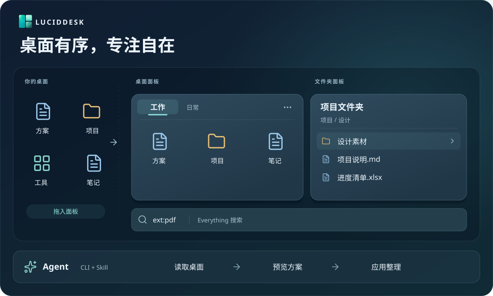

<div align="center">


# LucidDesk

简体中文 · [English](README.en.md)

**把 Windows 桌面整理成顺手的工作区，也能交给 Agent 协助打理。**

桌面面板 · 文件夹面板 · Everything 搜索 · 空格预览 · Agent 联动

[](LICENSE)
[](https://github.com/Yuch3nE/luciddesk/actions/workflows/build.yml)
[](CHANGELOG.md)
[](#系统与兼容性)
[](docs/portable.md)

[🌐 官网](https://luciddesk.bbkingdom365.com/) · [⬇️ 下载](https://github.com/Yuch3nE/luciddesk/releases/latest) · [✨ 探索功能](https://luciddesk.bbkingdom365.com/features/) · [📖 使用指南](https://luciddesk.bbkingdom365.com/guide/) · [📋 更新记录](CHANGELOG.md)

</div>

LucidDesk 是一款免费、开源的 Windows 桌面整理工具。用面板收纳文件和快捷方式，把常用目录放在桌面上，随时搜索和预览文件；也可以通过配套 CLI 与 Skill，让外部 Agent 协助整理。



<sub>功能示意，实际界面见下方截图。</sub>

[开始使用](#开始使用) · [功能](#功能) · [界面截图](#界面截图) · [升级与备份](#升级与备份) · [常见问题](#常见问题)

**0.25.2 更新**：修复图标拖入面板或拖回桌面后延迟刷新的问题，并完善搜索、图标加载和监控的异常退出处理。详见[更新记录](CHANGELOG.md#0252--2026-10-31)。

<a id="开始使用"></a>

## 🚀 开始使用

从 [GitHub Releases 下载](https://github.com/Yuch3nE/luciddesk/releases/latest)，日常使用推荐 **安装版**。三种发布包功能相同。

| 发布包 | 适合你，如果…… | 配置保存位置 |
| --- | --- | --- |
| 安装版（`*-setup.exe`） | 希望通过向导安装，并有开始菜单与卸载入口 | `%LOCALAPPDATA%\LucidDesk` |
| 普通 ZIP（名称不含 `portable`） | 希望解压即用，程序与配置分开保存 | `%LOCALAPPDATA%\LucidDesk` |
| 便携 ZIP（名称含 `portable`） | 希望配置随程序目录一起携带 | 程序目录中的 `data` |

1. 安装或完整解压发布包，启动 `luciddesk.exe`。ZIP 版请保留包内其他文件，不要在压缩包中直接运行。
2. 右键托盘图标，选择“新建面板”，将桌面图标拖入面板。
3. 拖动标题移动面板，拖动边缘调整大小；右键面板可调整排列、视图和图标大小。

要浏览常用目录，选择托盘菜单中的“新建文件夹面板…”。关闭设置窗口不会退出程序，需要退出时使用托盘菜单。

更多操作见[使用手册](docs/usage.md)；安装与迁移见[安装版](docs/installer.md)、[普通 ZIP](docs/package.md)和[便携版](docs/portable.md)说明。

<a id="功能"></a>

## ✨ 功能

| 功能 | 你可以做什么 |
| --- | --- |
| 桌面面板与标签 | 按项目收纳图标，合并或分离标签页；标签栏支持铺满和左对齐 |
| 灵活排列 | 自动排列、网格对齐或自由摆放，按名称、类型、时间或大小排序 |
| 独立显示设置 | 每个普通或文件夹面板分别选择图标／列表视图、纯图标模式及大中小图标 |
| 文件夹面板 | 直接浏览常用目录，进入子文件夹，文件变化后自动刷新 |
| 搜索与预览 | 连接 Everything 搜索本机文件，选中文件后按空格预览 |
| 外观与专注 | 调整主题、材质、字体和圆角；折叠、自动收起、吸附、锁定或置顶面板 |
| 双击隐藏桌面 | 在通用设置中启用后，双击空白处隐藏图标和面板，再次双击恢复 |
| 备份与恢复 | 自动或手动备份设置和布局，导出副本，按需恢复 |
| Agent 与 CLI | 让外部 Agent 查询桌面、预览整理方案并执行，也可编写脚本管理面板和备份 |

> [!NOTE]
> **普通桌面面板收纳图标不会搬动原文件。** 拖回桌面即可移出，移除面板不会删除原文件。删除、重命名、剪切等文件操作，以及向文件夹面板拖入或粘贴内容，会影响真实文件。

### 搜索与预览

这两项功能默认关闭，需要另行安装对应软件：

| 功能 | 准备与设置 |
| --- | --- |
| 文件搜索 | 安装并运行 Everything，在“设置 → Everything 搜索”中启用 |
| 空格预览 | 安装 PowerToys Peek 或 QuickLook，在“设置 → 文件预览”中选择并启用 |

这些软件不包含在 LucidDesk 发布包内，系统要求也可能高于主程序。当前 [PowerToys](https://learn.microsoft.com/windows/powertoys/install) 要求 Windows 10 2004（Build 19041）及以上；LucidDesk 的 1809 最低要求不代表 Peek 在 1809 可用。

### Agent 与命令行

在“设置 → 通用 → Agent 与 CLI”中复制 Skill 安装提示词，交给你的 Agent。主程序、CLI 和 Skill 应来自同一发布包；复制提示词本身不会执行安装。

先在设置中启用 CLI 控制，再在程序目录执行只读查询：

```powershell
.\luciddesk-cli.exe status --json
.\luciddesk-cli.exe pane list --json
```

整理流程分为三步：查询现有面板和项目 → 预览修改 → 确认后应用。例如，下面的命令只预览一个新面板，不会保存：

```powershell
.\luciddesk-cli.exe pane create --title "工作" --dry-run --json
```

检查返回的改动后，按 `data.next_step` 指引继续。**修改命令不带 `--dry-run` 时会直接预览并提交。** 若提交超时，先查原请求回执，避免重新运行修改命令造成重复操作；备份忙碌时按返回的条件等待，再重新预览。

CLI 支持 JSON 结果与可选诊断日志，适合 Agent 或脚本使用。LucidDesk 本身不内置大模型，也不需要配置模型 API 密钥。完整命令与恢复流程见 [CLI 指南](docs/cli.md)，Agent 接入见[配套 Skill](skills/luciddesk-control/SKILL.md)。外部 Agent 可能将文件名、路径等信息发送给其服务商，详见[隐私说明](PRIVACY.md)。

<a id="界面截图"></a>

## 📸 界面截图

| 桌面面板 | 主题与材质 |
| :---: | :---: |
| <a href="screenshot/zh/pane.png"></a> | <a href="screenshot/zh/setting.png"></a> |
| 拖入图标，按需折叠与整理 | 调整深浅主题与背景材质 |
| **文件夹面板** | **关于与运行状态** |
| <a href="screenshot/zh/folder.png"></a> | <a href="screenshot/zh/about.png"></a> |
| 浏览常用目录，查看类型、修改时间与大小 | 查看版本、项目入口与运行状态 |

点击截图查看原图。图中为深色亚克力，实际效果随壁纸和系统设置变化；Mica 系列仅在 Windows 11 提供。

<a id="升级与备份"></a>

## 🔄 升级与备份

在“设置 → 关于”检查更新并下载。程序不会自动安装新版本，升级前建议在“备份与恢复”中保存一份备份。

- **安装版**：退出程序，运行新安装包，沿用原来的安装范围和目录。
- **普通 ZIP**：退出程序，完整替换程序文件，保留配置目录。
- **便携版**：退出程序，替换程序文件，保留 `data` 文件夹和 `portable` 标记。

**备份包含设置和布局，不包含原始文件。** 换电脑时，面板引用的文件需要单独迁移。详细步骤见[使用手册](docs/usage.md#数据与备份)。

<a id="界面语言"></a>
<a id="系统与兼容性"></a>

## 🖥️ 系统与语言

| 环境 | 支持情况 |
| --- | --- |
| Windows 11 x64 | 主要维护平台，支持纯色、亚克力、Mica 和 Mica Alt |
| Windows 10 1809+ x64 | 已由用户实机验证，支持纯色和亚克力 |
| ARM64、远程桌面 | 尚未完整验证 |

支持简体中文、繁體中文、English、日本語、한국어、Deutsch 和 Русский。默认跟随 Windows 显示语言，不支持的语言回退到英语；可在“设置 → 通用”中切换，立即生效。

<a id="常见问题"></a>

## 💬 常见问题

<details>
<summary>登录后面板迟迟没有出现</summary>

LucidDesk 会在后台检测桌面接口，确认就绪后再连接；Explorer 重启后也会自动重试。若程序已经运行但面板未恢复，可在“设置 → 关于”查看连接状态并复制诊断信息。若托盘图标也迟迟未出现，请先在任务管理器中确认程序是否已启动：Windows 可能延后执行开机启动项，后台接口检测不会消除这段系统调度等待。

</details>

<details>
<summary>拖入面板或拖回桌面后，图标迟迟没有刷新？</summary>

先在“设置 → 关于”确认版本；0.25.2 修复了通知丢失导致的延迟刷新。普通桌面面板只改变图标归属，文件夹面板的拖入操作则可能涉及真实文件传输，两者的等待原因不同。升级后若仍出现延迟，请记录拖动方向、面板类型和等待时长，并复制诊断信息用于反馈。

</details>

<details>
<summary>图标和面板不见了？</summary>

点击托盘图标显示面板。如果启用了“双击隐藏桌面”，也可再次双击桌面空白处恢复。

</details>

<details>
<summary>桌面面板无法连接？</summary>

在“设置 → 关于”查看连接状态并尝试重新连接。重启 Explorer 后，程序会自动尝试恢复连接；若持续失败，请复制诊断信息用于反馈。

</details>

<details>
<summary>如何反馈问题？</summary>

在 [Issues](https://github.com/Yuch3nE/luciddesk/issues) 中提供复现步骤、预期与实际表现，以及“设置 → 关于 → 复制诊断信息”的内容。界面问题请附截图和屏幕缩放比例，分享前检查日志中的个人路径等信息。

</details>

<a id="文档"></a>

## 📚 更多帮助

[使用手册](docs/usage.md) · [CLI 指南](docs/cli.md) · [更新记录](CHANGELOG.md) · [隐私说明](PRIVACY.md) · [文档导航](docs/README.md)

<a id="源码构建"></a>
<a id="参与开发"></a>

## 🤝 开发与贡献

欢迎提交问题、功能建议、翻译改进或 Pull Request。参与开发前请阅读[贡献指南](CONTRIBUTING.md)。

项目使用 Rust、Win32 与 Direct2D。编译和打包见[构建指南](docs/development/build.md)，实现与验证见[开发文档](docs/development/README.md)，网站维护见[官网开发说明](website/README.md)。

项目作者：**Yuchen95**。

<a id="友情链接"></a>

## 🔗 友情链接

[Linux DO](https://linux.do/)

<a id="许可证"></a>

## 📄 许可证

LucidDesk 使用 [MIT License](LICENSE)，第三方依赖遵循各自的许可证。
