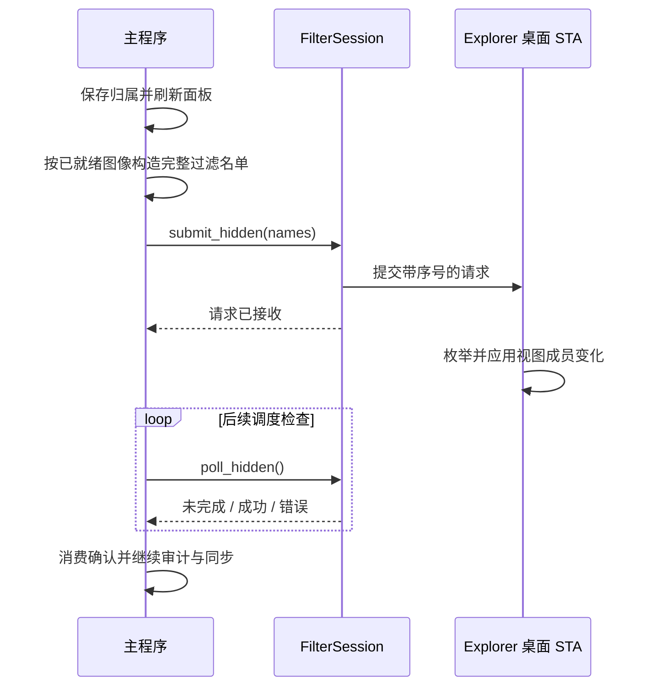

# 原生桌面与成员过滤

本文说明桌面项目从收纳、同步到恢复的完整流程。应用使用 `FilterSession` 管理 Explorer 视图成员，面板由独立窗口自绘；进程分工和 DLL 生命周期见[架构说明](architecture.md)。

## 连接调用链与重入边界

下表按执行顺序列出主链路。STA 上的同步 Win32/COM 调用可能派发回调，不能把“单线程”视为“不会重入”。

首次启动和断线重连先执行后台只读就绪探测。`desktop_ready::Probe` 在独立 STA 上获取 `IFolderView2`，读取视图参数和两次一致的项目 ID 清单，不解析文件元数据或加载图标。它核对桌面窗口/PID 与 Shell 视图的父窗口关系，UI 消费结果时再次核对窗口/PID，然后才进入下表的完整清单和 Hook 连接流程。空桌面和隐藏图标均不作为失败依据；后台结果不会直接修改桌面成员。

同一时刻只保留一个探测任务，结果通过 `Wake` 唤醒 UI，不使用轮询心跳或在 UI 线程等待。接口未就绪时以 250ms、500ms、1s、2s 的退避重试，上限 2 秒；连接组件失败仍保留原有最高 10 秒的退避。启动或断线后的前 30 秒，普通就绪失败不弹出警告，持续失败沿用连接故障提示。诊断级别为 Info 时记录 `desktop.readiness` 的结果及耗时。单个 COM 调用没有硬超时保证；若工作线程卡住，不并行创建替代线程，主界面保持可响应。探测成功后的完整枚举和 Hook 握手仍在原有 UI STA 上执行。

| 阶段 | 代码入口与线程 | 等待及重入约束 |
| --- | --- | --- |
| 定位与初始清单 | UI：`runtime::reconnect → hybrid::connect → desktop_view → inventory::capture` | `reconnecting` 阻止再次连接。先复制托管身份，再释放 `PaneApp` 借用，之后才调用 Shell 枚举；不能把 `state.borrow()` 临时值留在 COM 调用的实参中。 |
| 注入与握手 | UI：`FilterSession::connect → wait_for_attach`；Explorer：Hook 安装 Subclass | 验证窗口、PID、线程及旧 DLL 释放状态。握手泵送 UI 消息并检查视图是否替换；这一步不持有应用状态借用。 |
| 首次发布 | UI：`reconcile_inventory → sync → submit_hidden` | 安装会话后提交完整名单。初始化失败时先从应用取出会话、释放借用，再销毁会话，避免 DETACH 回调重入被借用的应用。 |
| 请求与确认 | UI：`transmit/send`；Explorer：`WM_COPYDATA → pending → work_message → apply_request → ACK` | 接收只复制请求，实际 Shell 操作排队执行。单个会话只有一个 ACK 槽；发送及同步等待全程持有请求保护，回调中的嵌套请求在分配序号、创建更新令牌或发送前被拒绝。异步提交返回后由 `pending_hidden` 接续保护，直到 `poll_hidden` 消费确认。 |
| 选择与预览 | UI：焦点 `post_action → PaneItemFocus → clear_selection`；预览 `activate_with → PAUSE → Peek → RESUME` | 焦点同步必须先返回 Explorer 的同步通知；代次校验丢弃旧任务。普通 ACK 等待只服务 sent messages，不分派排队应用动作。预览在排队动作实际执行时检查会话的菜单/预览占用；占用中直接跳过，不发送 PAUSE/RESUME，也不释放他人的占用。暂停与恢复期间仍可能接收同步窗口回调。 |
| 文件菜单与重命名 | UI：`BeginItemMenu → shell_menu::show_many`；Explorer 桌面 STA → 独立菜单 STA | 菜单请求等待会泵送 UI 消息，调用前释放应用、模型和事件借用，单独持有 Hook。菜单准备失败也取消；桌面 STA 等菜单线程时只服务同步回调。重命名先保存实际文件操作结果，再同步身份与完整名单，最后释放带序号的更新令牌。 |
| OLE 拖放 | Explorer → `drag_drop::target::Drop → hybrid::register_drop` | 完成拖动辅助对象和描述清理后才排队成员变化；Drop 返回前不等待 Explorer 的过滤工作。拖出和文件夹复制也在释放借用后执行 Shell 操作。 |
| 审计、断开与恢复 | 后台 STA：`DesktopAudit`；UI：`hybrid::tick → runtime::maintain/suspend/reconnect` | 后台结果通过通道回传，带成员身份版本校验。异常会话取出后在借用外销毁；正常退出及初始化回滚遵守同一规则。Explorer 恢复验证完成前保留组件引用；菜单线程退出及 DLL 释放由独立生命周期机制处理，不在桌面 STA 上 join。 |

请求保护是单 ACK 槽的轻量协议约束：同一会话有请求执行时，嵌套提交立即返回错误，不等待、不排队、不新增自动重试，也不将会话标记为损坏或触发重连。保护采用作用域释放，成功、传输拒绝、断开和超时返回都会释放；身份更新的带序号释放标记仍可用于清理。应用层的 `menu_active`、成员同步状态和延迟调度继续负责正常操作的互斥与时序。

协议测试人为构造同步发送和菜单 ACK 等待期间的嵌套回调，覆盖异步提交、序号与更新令牌不被污染、拒绝重入后会话仍健康，以及传输失败后仍可发下一请求。它验证客户端边界，不能单独作为现场故障的复现证据。初始清单读取直接用局部变量结束借用，不保留仅为注入测试而设置的泛型包装。两处借用修正还需结合第三方 Shell 扩展和连接失败场景进行实机验证。

### 实际入口审查：菜单等待与 Peek 交错

修复前应用层存在一条未被菜单状态拦截的预览路径：`WM_CONTEXTMENU → BeginItemMenu → prepare_menu → send` 等待 ACK 时会分派所有排队消息；此时预览快捷键仍可经过 `WM_KEYDOWN → Event::Peek → activate_with → post_action → pause_for_preview → hook.pause(true)`。窗口的局部 `menu_active` 阻止再次打开菜单，但通用快捷键分支没有据此阻止 Peek；会话的 `menu_active` 已为 true，`pause_for_preview` 却没有检查它。排队动作在 Subclass 中执行，普通窗口事件回调仍可用，因此回调临时脱离机制也不会封住此路径。需要桌面分组有选中项、启用 Peek（非 QuickLook），并且预览任务在菜单请求等待期间被分派，例如菜单准备较慢时按预览快捷键。

这是基于生产代码和真实消息分派规则识别的可达路径，尚未实机捕获菜单准备 ACK 被嵌套请求覆盖的历史故障时序。`in_flight` 在客户端拒绝第二次提交。若移除它，Explorer 正忙时可能拒绝请求；若外层菜单 ACK 已写入、客户端尚未消费，嵌套 PAUSE/RESUME 被接受并完成后可能覆盖共享 ACK，令外层等待到超时。Explorer 的 PAUSE 分支也没有拒绝 `menu_prepared` 状态，不能假设服务端菜单互斥会兜底。不能将这些条件性后果描述为每次快速右键加预览都会发生。

应用层现已在 `pause_for_preview(true)` 检查并取得会话占用。检查位于 `activate_with` 的排队动作内，因此不依赖快捷键收到时的状态，也不依赖是哪一个分组发起。被跳过的动作既不打开 Peek，也不调用恢复；暂停失败则释放本次取得的占用并返回原错误。QuickLook 和文件夹的按路径预览不提交桌面过滤请求，继续走原路径。协议层保留轻量请求保护，不增加排队、重试或重连。

实机回归脚本 `tools/validation/test-preview-menu.py` 使用独立数据目录中两个各有一个文本文件的桌面分组；先配置 Peek 和 Space 快捷键，并确认默认网格的首个图标可点击。参数为 `--pid <测试进程> --cli <CLI路径> --data-dir <隔离目录> --panes <分组A名称> <分组B名称> --fixtures <文件A名称> <文件B名称> --report <报告路径>`。脚本真实点击打开 Explorer 菜单，通过窗口键盘消息进入 `Event::Peek → post_action`，检查两组的排队预览未改变 ACK、未打开 Peek、未释放菜单占用；随后关闭菜单，逐组验证 Peek 正常打开并恢复同步。菜单宿主会缓存，结束判定使用会话状态，不能仅检查宿主可见性。

2026-10-20 在 Windows build 26300 上完成五轮上述组合（10 次菜单期间请求、10 次菜单结束后预览），以及 10 轮 Win+D 隐藏/恢复和 10 轮从专用测试窗口返回桌面；会话 Owner 保持不变，无超时或错误弹窗。该脚本验证真实应用的排队执行路径，但通过定向窗口消息安排交错，不代表物理键盘自然复现了菜单准备 ACK 的竞态，也不证明所有 Shell 扩展均不会重入。

探索脚本阶段另有一次同步注入方向键后的异常退出。转储栈中的符号对应 `PaneItemFocus → clear_desktop_selection` 等待期间重入 `window::create` 的方向键分支，随后在事件回调的 `RefCell::borrow_mut` 处 panic。栈扫描不是完整展开，但与该脚本的同步消息时序及现有源码一致；不能将其认定为物理键盘自然触发，也不能用后续通过掩盖这一未修复边界。菜单回归脚本使用 `PostMessageW`，不直接同步注入 `WM_SETFOCUS/WM_KEYDOWN`。后续审查确认并修复了以下不依赖同步按键注入的错误提示分支。

## 事件回调借用与错误提示

实际链路为 `WM_SETFOCUS → post_action → events.try_borrow_mut → PaneItemFocus → clear_desktop_selection`。成功的普通 ACK 等待只服务 sent messages；普通物理键盘输入是排队消息，不能仅凭“Windows/COM 会重入”断定方向键会在这里执行。窗口回调中的焦点通知已排队，激活/位置通知的自动隐藏处理也延后到定时器；尚未确认成功等待分支中自然触发同一借用 panic 的系统消息序列。

但请求错误会返回 `create_view` 的事件回调；它仍持有 `events` 的可变借用，并曾直接调用 `window::error → MessageBoxW(NULL, MB_OK | MB_ICONWARNING)`。MessageBox 使用完整模态消息循环；该无 owner、未设置 `MB_TASKMODAL` 的对话框不会禁用分组窗口。用户点击原分组、按键或已有自动隐藏定时器均可回到事件入口。这是正常错误处理加正常 Windows 消息分派可达的分支，不需要 Shell 扩展同步发送键盘消息。

最小修复只把 `create_view` 的错误框通过已有 `defer_action` 延后显示，让事件回调及其借用先结束；错误日志仍立即记录。调度失败时保留日志，不回退为同步弹框。没有新增通用事件队列、重试，也不以 `try_borrow_mut` 静默丢弃用户操作。该修复不承诺支持任意外部同步注入输入消息。

`pane::window::error_tests` 使用真实 MessageBox 的定时器分派，比较直接显示和生产 `defer_error` 路径：确认模态期间分组仍启用，旧路径借用不可用，新路径回调能成功执行。测试自动关闭自己的错误框，不同步注入键盘/焦点消息，也不强制真实 Explorer 超时。它验证错误提示处的重入条件与修复，不是历史转储首次故障的自然复现。

参考：[MessageBox 的 owner 与模态范围](https://learn.microsoft.com/en-us/windows/win32/api/winuser/nf-winuser-messageboxw)、[PeekMessage 的分派范围](https://learn.microsoft.com/en-us/windows/win32/api/winuser/nf-winuser-peekmessagew)。

## 接口失败与恢复

`IShellFolderView` 仍是需要兼容性验证的旧接口；使用它不代表获得跨 Windows 版本保证。所有增删与恢复都在 Explorer 桌面 STA 执行，不创建替代桌面视图。

- 文件存在性检查只把 `ERROR_FILE_NOT_FOUND`、`ERROR_PATH_NOT_FOUND` 视为确认不存在。权限、网络及其他错误保留恢复记录并中止本批写入。
- `RemoveObject` 前保存恢复 PIDL，避免调用发生部分副作用后返回错误时丢失记录。刷新后再次隐藏时使用新快照中的 PIDL。
- `AddObject` 返回成功后仍需在视图中观察到项目；整个释放集合验证通过才删除恢复记录。移除批次同样检查目标确实消失。无关项目的增删不作为这两个目标集合校验的失败条件；底层快照仍要求读取一致。
- 写入或结果验证失败后停止新增隐藏，进入仅恢复状态。恢复失败时尝试 `IShellView::Refresh`，其成功不等于恢复完成；后续消息循环重新验证。恢复尝试按 250ms 起步指数退避，最高 60 秒一次，不在 STA 中 sleep 或等待刷新。
- 正常退出、控制窗口销毁和进程退出均使用同一恢复路径。恢复尚未确认时保留 State、PIDL、Subclass 和 DLL 引用；新连接会得到恢复未完成的诊断。只有验证成功才释放会话。原生视图本身销毁则释放旧状态，由 Explorer 新视图重新枚举数据源。
- `status --json` 的 `desktop_diagnostic` 包含阶段、HRESULT、OS Build、Explorer PID、视图句柄和恢复状态。初始错误与恢复／刷新错误分别保留；`recovery=verified` 表示恢复验证通过，历史错误码仅用于诊断。记录在下一次连接时重置。

故障测试使用与 COM 路径共用的成员事务和恢复调度逻辑，注入属性访问失败、Add 失败或无效成功、Remove 写入后报错或无效成功、验证读取失败、Refresh 失败及延迟恢复。运行 `cargo test -p luciddesk-explorer --lib filter:: -- --test-threads=1`。

实机验收：先关闭已授权的调试实例，构建 `luciddesk`、`luciddesk-explorer`、`luciddesk-cli` 和 `luciddesk-shell --example desktop_snapshot`，再运行 `tools/validation/test-filter-recovery.ps1`。脚本使用隔离工作区和唯一测试文件，验证正常／强制退出、每种场景三轮收纳释放、原生视图可见性、源文件内容及坐标。它不向真实 Explorer 注入故障，也不覆盖其他 Windows 构建的兼容性。

## 收纳与显示

收纳改变项目的显示归属，不删除或移动源文件，也不切换系统自动排列设置。Explorer 绘制未收纳项目，LucidDesk 绘制面板内容。DLL 在 Explorer 桌面 STA 上调用 `IShellFolderView::RemoveObject` 移除对应视图成员；自动排列开启时由 Explorer 补位，关闭时沿用系统布局行为。

需要区分三种集合：

| 集合 | 含义 | 维护位置 |
| --- | --- | --- |
| 工作区成员 | 用户保存的桌面分组归属 | 主程序与持久化工作区 |
| 过滤名单 | 当前应从原生视图移除的完整 Shell 解析名集合 | 控制端发布，Hook 保留并应用 |
| 原生视图成员 | Explorer 当前可见的桌面项目 | Explorer；可能因刷新短暂变化 |

工作区成员不会立即全部进入过滤名单：只有图像已就绪的成员参与过滤，初次图标加载失败时保留原生图标，避免两边都没有可用显示。原生视图中缺少某项目，也不等于该文件已删除。

### 一次收纳的同步顺序

`submit_hidden` 不等待 Shell 完成整批枚举与更新；`poll_hidden` 根据对应请求序号检查完成结果。前一请求未完成时不提交另一事务，成员同步在途期间暂缓清单消费、桌面选择清除和文件菜单准备。

Shell/COM 嵌套消息循环可能在过滤状态被外层回调借用时取走工作消息。Subclass 遇到这类重入时设置 25ms 恢复定时器，待状态释放后继续处理，不立即重投消息造成嵌套循环空转；待确认的请求也参与恢复定时器调度。

### 过滤请求超时诊断

分组 `WM_SETFOCUS` 且保留选中项时，需要清除原生桌面选择。该操作必须通过 `post_action` 在焦点回调返回后执行，并重新检查分组仍有焦点和选中项：如果 Explorer 线程同步发送焦点通知，回调内等待过滤 ACK 会形成循环等待。Explorer 可以在等待发送结果时接收同步 `WM_COPYDATA`，但不能执行后续排队的过滤工作；因此会出现“请求已接受但 ACK 超时”。客户端仅泵送 sent messages 不能解除这个等待环。`client_focus_tests` 用两个独立窗口线程验证内联调用超时，而延后调用无需重连即可完成；这证明该触发条件成立，不等于确认历史日志中的焦点发送者。

普通同步请求被接受但等待 ACK 超时后，客户端将会话标记为失效；即使窗口、Owner 属性仍存在或稍后收到旧 ACK，也不复用它。运行时按原有恢复流程释放会话并尝试重连，释放期间不持有应用状态借用。清理请求仍可发送；失效会话上的焦点同步只唤醒恢复调度，避免错误弹窗关闭后再次获得焦点导致连续弹窗。菜单事务保持独立的取消和清理流程，不因菜单准备超时直接断开桌面。

同步请求超时日志包含 `op`、`sequence`、当前 `ack`、`elapsed_ms`、`owner_match`、`request_error`、`in_send` 和桌面阶段摘要。`in_send` 为 `InSendMessageEx` 返回的消息调用状态，辅助判断是否仍在处理跨线程同步通知。`op=1/2/3/4/5` 分别表示成员同步、清除选择、暂停、恢复、断开；`6/7/11` 为菜单准备、完成、取消，`8/9/10` 为身份更新开始、结束、替换。序号不匹配只能说明尚未观察到对应确认，不能单凭超时判定 Explorer 已挂死。

再次复现时，在重启前保存数据目录下的 `logs/diagnostic.log` 和 `logs/diagnostic.previous.log`（若存在），复制“设置 → 关于 → 复制诊断”，并执行 `luciddesk-cli status --json` 保存当前连接状态。记录触发操作及时间、持续运行时长、是否刚使用预览或右键菜单。可提前在“设置 → 常规 → 诊断日志”选择 INFO 以记录连接恢复；新增超时详情在默认 ERROR 级别也会记录，无需开启渲染跟踪。日志不足以确认历史现场是否与丢失唤醒为同一原因，仍需用修复版本观察是否复发。

名单排序、去重后与发布缓存比较，只在变化时提交；Hook 自行保留成功应用的过滤状态。发送前先使发布缓存失效：IPC 错误不能证明 Explorer 未执行请求，错误或部分更新后必须重新发布权威名单，不能因名单“看起来没变”跳过补偿。收到失败确认时清除在途状态、标记待同步并由运行时重试。

桌面到分组的 OLE Drop 先完成 Shell 拖动辅助对象和临时描述清理，再通过排队动作提交收纳，避免双方 STA 相互等待。文件夹面板的文件复制和移动不使用这套收纳协议。

## 清单与刷新

### 身份与清单合并

`hybrid/inventory.rs` 合并当前原生视图和独立桌面来源。来源中只补入已有分组成员，不把 desktop.ini 等无关隐藏项目显示在面板中。文件 ID 支持改名后保留归属；不完整快照、重复身份或来源枚举错误不会提交为删除。

### 有界快照读取

原生布局和轻量修订读取会核验前后项目标识、顺序、视图窗口和图标参数；项目数量变化、重复标识及无效标识也会使本次读取作废。索引越界（`E_BOUNDS`）或一致性检查失败时，从头重新读取，单次调用最多三次；其他接口错误直接返回。持续变化时保留现有面板数据，由既有调度稍后重试，不调用桌面刷新。逐项读取失败会在日志中附带接口名、索引和开始时的总数。这是有界一致性检查，不会锁住 Explorer，也不保证读取结束后桌面不再发生变化。

### 通知、后台审计与过时结果

常驻 STA 检查原生视图修订和独立来源 PIDL 集合；连续无变化时，检查间隔按 2、4、8 秒退避，上限为 8 秒。变化通知触发优先核对，读取期间的新通知保留到下一次强制读取；仅在修订、成员或通知变化时解析完整元数据。后台结果携带请求时的分组成员键，丢弃已过期的结果。图标通知和回收站空满变化继续使用单独刷新路径；通知缺失时，清单变化可能等待约 8 秒才被发现。

文件身份和解析名都参与成员修订判断。即使改名前后的文件 ID 相同，使用旧路径的在途结果也不能覆盖新身份。拖放改变归属时同样使旧结果失效；选择互斥和请求顺序见[选择与刷新时序](selection-latency.md)。

上述退避间隔是调度条件，不是严格的实时响应期限。控制端清单审计与 Explorer 内的事件驱动重滤承担不同职责，不能互相替代。

## 图像就绪与缓存

分组中使用的图像继续保留；最近移出的图像允许短期复用，最多 64 项且像素缓冲容量总计不超过 8 MiB，超过预算先淘汰最早移出的项目。运行时按最早过期时间安排单次唤醒，移出 30 秒后回收，菜单或预览暂停期间延后处理。普通维护不延长期限，快速移回时可直接复用共享图像。Shell／图标通知和清单变化提前清除闲置缓存，避免复用已知过期内容。这些预算仅针对闲置图像，不是整个进程的内存上限。

同步路径清除已移出项目的失败重试记录。初次加载和刷新结果都核验当前分组归属，避免迟到结果重新缓存已移出的图像；像素未变化时保留原有共享图像，复用 GPU 缓存。

缓存所有权、像素去重和预算说明见[图标内存管理](memory-optimization.md)。图像缓存影响显示与复用，不替代工作区归属或文件存在性判断。

## Explorer 侧过滤与重绘

“显示桌面图标”关闭时不再提前拒绝连接，连接仍须通过窗口定位、完整清单读取和 Shell 接口校验。整体隐藏是用户的显示偏好，LucidDesk 不主动开启该选项。此行为已有窗口级显示切换回归测试；真实 Explorer 隐藏状态下的全链路兼容性仍需实机验证。

DLL 在列表变化后排队重新过滤；只在排队唤醒失败、读取重试或事务释放等待期间设置恢复定时器，常驻生命周期定时器不枚举成员。自发的 RemoveObject 不递归触发自身过滤。刷新期间仍可能短暂重新出现项目，目前不承诺完全消除闪现。

列表变化同时监听子窗口的 `LVM_*` 消息和父窗口的 `LVN_INSERTITEM`、`LVN_DELETEITEM`、`LVN_DELETEALLITEMS` 通知。只要过滤名单非空，`WM_PAINT` 和 `WM_PRINTCLIENT` 前都会核对成员，不再以“已收到变化通知”为前提；Peek、改名事务和已失败会话仍遵守各自的暂停边界。这样覆盖启动刷新绕过变化消息的情况，代价是在实际绘制时增加快照读取；没有变化时不额外发起重绘或启动定时巡检。父窗口通知内仅排队，不直接修改正在被通知的列表。

绘制前核对、列表变化处理、过滤名单请求和事务释放使用统一的重绘保护：子类回调拦截绘制，仅在实际调用添加、移除或定位接口后请求重绘，无变化的枚举不触发整窗失效。成员过滤事务不发送 `WM_SETREDRAW` 来开关重绘，避免其改变 `WS_VISIBLE`；保护期间也拦截 Shell 重入的 `WM_SETREDRAW`，但不拦截用户的显示/隐藏操作。所有这些入口在枚举期间均阻挡 COM 重入绘制，避免新插入的托管成员先显示出来。非事务调用在返回或展开异常时释放保护；Peek 和改名事务保留保护直到事务结束。过滤名单由 Hook 保留并在变化事件后重新应用，控制端仅在名单变化时发布，普通清单读取失败时保留已成功发布的名单。改名事务的身份交接仍会按需重新发布。

恢复坐标时，未添加项目且坐标已经相同便跳过定位接口；添加项目后仍按初始顺序恢复，以兼容自动排列。Peek、改名事务、退出或部分写入失败后的恢复仍可能产生必要重绘；`IShellView::Refresh` 仅用于成员恢复失败后的兜底。只读失败连续超过现有重试预算后也会进入恢复，不能据此承诺桌面永不刷新。

双击恢复整个桌面的 ListView 显示是独立路径：在 Explorer 线程内用成对的 `WM_SETREDRAW` 包住显示操作，立即重绘后返回，再由面板执行淡入。此处确实需要改变可见性，不与上面的成员过滤事务混用。手势有效期、恢复状态和验证方法见 [Hook 验证指南](hook-validation.md)。

## 菜单与恢复

### 不同操作的事务边界

| 操作 | 原生成员与重绘处理 | 身份及结束处理 |
| --- | --- | --- |
| 文件菜单 | 保持过滤，独立宿主拥有自己的选择 | 准备时校验身份；普通命令交给 Shell，`rename` 返回面板 |
| Peek 预览 | 调用作用域内暂时恢复成员并暂停原生列表重绘 | 结束后重新过滤并恢复重绘 |
| 托管成员改名 | 暂停绘制但保持过滤 | 保存新身份、交接过滤身份、发布完整名单后结束事务 |
| 退出或控制端消失 | 恢复仍存在的原生成员，解除重绘暂停 | 用户的新布局操作优先于旧坐标基线 |

文件菜单不需要临时恢复真实桌面选择。菜单宿主、改名编辑器和身份补偿见[菜单与重命名](pane-item-rename.md)；底层命令路由见[精简菜单技术文档](../win11-compact-menu-command-routing.md)。

### 成员与坐标恢复

退出或控制端消失时重新加入仍存在的项目。没有用户布局操作时，按原视图顺序批量恢复原坐标；用户的拖动、排序和显示器变化优先于旧基线。成员恢复失败时按恢复状态机请求 Shell 刷新并继续核验；成员已恢复后的坐标错误只记录警告，不触发全量刷新。文件已经删除或改名时，不使用过期路径重新加入图标。

恢复成员与卸载 DLL 是两个阶段。清理还必须撤销回调、等待菜单线程和桌面回调退出，才能释放模块；不能把主程序退出当作 DLL 已可替换的证据。控制端异常退出也依赖 Explorer 内的存活监测解除事务重绘暂停。具体释放顺序见[退出与异常终止](architecture.md#退出与异常终止)。

## 边界

- 原生桌面接口通过运行期探测使用，不能保证所有 Windows 构建及 Shell 扩展组合兼容；Windows 11 x64 是优先维护平台。
- 快照读取不会锁住 Explorer。持续变化可能导致读取放弃并延后重试，但不能把读取失败当成成功删除。
- 刷新期间可能短暂重现原生项目；恢复失败允许 Shell 刷新兜底，不承诺完全无闪现或永不刷新。
- 桌面会话失效时保留分组归属并安排重连，独立文件夹和搜索来源继续运行。

### 修改后的验证重点

| 修改范围 | 至少验证 |
| --- | --- |
| 过滤发布与确认 | 单个在途请求、失败后的重新发布、空名单回滚和迟到确认 |
| 清单或身份 | 改名、删除、重复身份、不完整读取及读取期间发生的新通知 |
| 图标加载与缓存 | 初次失败、迟到结果、移出再移回、通知失效和预算回收 |
| 菜单、Peek 或改名 | 成功、取消、异常路径均结束事务并恢复必要的重绘状态 |
| 分离与恢复 | 正常退出、控制端异常消失、用户改变布局后的恢复，以及 DLL 释放 |

自动检查不替代多屏、混合 DPI、自动排列开关和实际 Shell 扩展环境中的回归。检查方法与平台限制见[验证与兼容边界](validation.md)。

## 连接降级与恢复隔离

- 恢复成员直接核验保留的 PIDL，不先读取整个桌面的名称或坐标。未知存在性、添加失败和添加后核验失败均保留恢复记录；逐项清除已确认恢复或已删除的记录，单项失败不阻挡其他项目。成员确认可见后，布局读取或定位失败作为警告记录，立即完成清理，不触发全量刷新。
- 回收站通知是可选订阅。失败不拆除桌面连接，每 30 秒重试一次，并触发回收站图标刷新补偿通知缺口；订阅成功后停止定时重试。
- 首次清单同步只标记工作区待保存。会话保留，保存失败独立按 5 秒间隔重试；图标刷新和已提交请求的确认继续执行。保存成功前不发布新的过滤名单、不合并新清单覆盖待保存修改，成功后唤醒同步。CLI status 的 `workspace_save_pending` 表示保存尚未完成，与 `desktop_connected` 分开报告。
- 故障测试覆盖不可读布局下恢复、空恢复清单清理、添加后核验失败保留记录、可选订阅退避与恢复，以及保存失败期间保留已发布名单。
